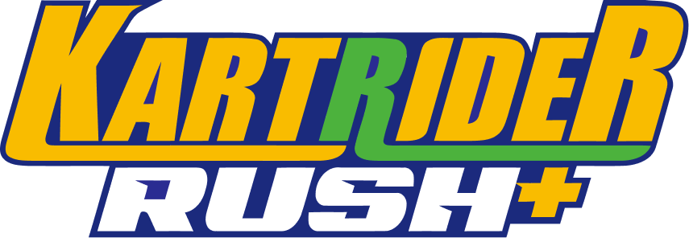
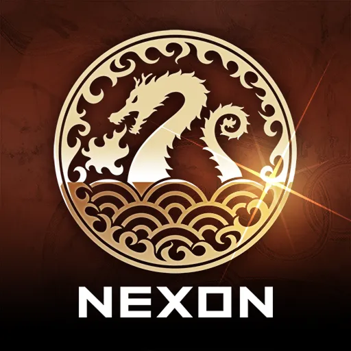

# nexon-open-api

> 넥슨 Open API로 디스코드 봇·팬사이트·계산기 같은 도구를 만들 때, **내 코드에 설치해서 쓰는** TypeScript/JavaScript 라이브러리(npm 패키지)입니다.

[](https://www.npmjs.com/package/nexon-open-api)
[](https://github.com/Kimhasa/nexon-open-api-sdk/actions/workflows/ci.yml)
[](https://opensource.org/licenses/MIT)
[](https://nodejs.org/)

완성된 앱이나 웹사이트가 아닙니다. 캐릭터 이름으로 레벨·장비·전적·랭킹을 가져오는 **부품**이고, 화면과 기능은 만드는 분이 정합니다. [넥슨 Open API](https://openapi.nexon.com/)의 14개 게임과 Open API 공지를 다루는 비공식 라이브러리입니다.

```js
import { NexonClient } from 'nexon-open-api';

const client = new NexonClient({ apiKey: process.env.NEXON_API_KEY ?? '' });
const ocid = await client.maplestory.getOcid('캐릭터명'); // 캐릭터 이름 → 고유 번호
const basic = await client.maplestory.character.getBasic({ ocid }); // 기본 정보
console.log(`${basic.character_name} Lv.${basic.character_level} ${basic.character_class}`);
```

## 왜 직접 fetch하거나 AI가 짠 코드 대신 쓰나요?

- **실제 응답에 맞춘 타입입니다.** 넥슨 문서와 실제 응답은 다른 곳이 있습니다. 실제 키로 263개 조회를 대조했을 때 처음에는 127개에서 600종이 넘는 차이가 나왔고, 모두 실제 응답에 맞췄습니다. → [문서대로 짜면 터지는 곳](docs/why.md#같은-일-두-가지-코드)
- **넥슨이 직접 경고한 함정을 대신 처리합니다.** 넥슨의 [AI 에이전트 가이드](https://openapi.nexon.com/ko/guide/ai-agent/)가 꼽은 문제(없는 캐릭터에 "파라미터 오류", 조용히 무시되는 필터, 재시도하면 안 되는 에러)를 라이브러리가 맡습니다. → [가이드 항목별 대응표](docs/why.md#넥슨-ai-가이드와-이-라이브러리)
- **14개 게임이 한 패키지이고 의존성이 0개입니다.** 에디터에서 `client.` 만 입력하면 게임, 조회 항목, 응답 필드가 게임 용어 설명과 함께 자동완성됩니다. → [다른 라이브러리와 비교](docs/why.md#다른-라이브러리와-비교)

AI에게 코드를 맡길 때도 쓸 수 있습니다. "nexon-open-api 로 짜 줘"라고 하면 AI가 검증된 필드 이름과 에러 처리를 그대로 씁니다 ([AI와 함께 쓰기](docs/ai-guide.md)).

## 이런 걸 만들 때 씁니다

| 만들고 싶은 것                          | 여기서 시작하세요                                                                                                            |
| --------------------------------------- | ---------------------------------------------------------------------------------------------------------------------------- |
| 환산 계산기 (장비·잠재능력 옵션 모으기) | [레시피](docs/recipes/)                                                                                                      |
| 코디 카드 (캐릭터 외형 이미지)          | [레시피](docs/recipes/)                                                                                                      |
| 디스코드 봇의 `!정보 캐릭터명`          | [캐릭터 카드 예제](examples/maplestory-character-card.mjs), [봇 형태로 쓰기](docs/getting-started.md#6-디스코드-봇처럼-쓰기) |
| 전적 검색기                             | [FC 온라인 전적 예제](examples/fconline-recent-matches.mjs)                                                                  |
| 경매장 시세 도구                        | [마비노기 경매장 예제](examples/mabinogi-auction-price.mjs)                                                                  |
| 랭킹 페이지, 도감, 뿔피리 모아 보기     | [예제 전체 목록](examples/README.md)                                                                                         |

## 지원 게임

넥슨 Open API 포털의 **14개 게임 전부와 Open API 공지**를 지원합니다 (2026-11-24 포털 기준, 조회 270개). 넥슨 API가 바뀌는지 매주 자동으로 확인합니다.

<!-- 아이콘 파일: docs/assets/games/{game}.png -->
<!-- prettier-ignore-start -->
<table width="100%" cellspacing="0" cellpadding="8" style="table-layout:fixed;width:100%">
<tr>
<td align="center" valign="top" width="33%"><br><h4>메이플스토리</h4><sub>캐릭터 스펙·장비·유니온, 랭킹, 스타포스·큐브 기록</sub><br><br><a href="docs/maplestory.md">문서 보기</a><br><br></td>
<td align="center" valign="top" width="33%"><br><h4>메이플스토리M</h4><sub>캐릭터 스탯·장착 아이템, 길드, 전투력·무릉도장 랭킹</sub><br><br><a href="docs/maplestory-m.md">문서 보기</a><br><br></td>
<td align="center" valign="top" width="33%"><br><h4>EA SPORTS FC 온라인</h4><sub>공식경기 전적, 역대 최고 등급, 선수 이미지</sub><br><br><a href="docs/fc-online.md">문서 보기</a><br><br></td>
</tr>
<tr>
<td align="center" valign="top" width="33%"><br><h4>MapleStorySEA</h4><sub>MapleStory SEA의 캐릭터·유니온·길드</sub><br><br><a href="docs/maplestory-sea.md">문서 보기</a><br><br></td>
<td align="center" valign="top" width="33%"><br><h4>MapleStory Taiwan</h4><sub>MapleStory Taiwan의 캐릭터·유니온·길드</sub><br><br><a href="docs/maplestory-tw.md">문서 보기</a><br><br></td>
<td align="center" valign="top" width="33%"><br><h4>퍼스트 디센던트</h4><sub>계승자·무기·모듈 도감, 장착 정보, 리더보드</sub><br><br><a href="docs/first-descendant.md">문서 보기</a><br><br></td>
</tr>
<tr>
<td align="center" valign="top" width="33%"><br><h4>마비노기</h4><sub>경매장 매물·거래 내역, NPC 상점, 거대한 외침의 뿔피리</sub><br><br><a href="docs/mabinogi.md">문서 보기</a><br><br></td>
<td align="center" valign="top" width="33%"><br><h4>마비노기 영웅전</h4><sub>캐릭터 장비·능력치, 거래소 기록, 명예의 전당 랭킹</sub><br><br><a href="docs/mabinogi-heroes.md">문서 보기</a><br><br></td>
<td align="center" valign="top" width="33%"><br><h4>서든어택</h4><sub>계급·티어, 최근 동향, 매치 기록</sub><br><br><a href="docs/sudden-attack.md">문서 보기</a><br><br></td>
</tr>
<tr>
<td align="center" valign="top" width="33%"><br><h4>카트라이더 러쉬플러스</h4><sub>라이더 기본 정보·장착 칭호, 시즌 알림판</sub><br><br><a href="docs/kartrider.md">문서 보기</a><br><br></td>
<td align="center" valign="top" width="33%"><br><h4>바람의나라</h4><sub>캐릭터 능력치·장착 아이템·칭호·길드</sub><br><br><a href="docs/baram.md">문서 보기</a><br><br></td>
<td align="center" valign="top" width="33%"><br><h4>바람의나라: 연</h4><sub>캐릭터 기본 정보·칭호</sub><br><br><a href="docs/baram-yeon.md">문서 보기</a><br><br></td>
</tr>
<tr>
<td align="center" valign="top" width="33%"><br><h4>V4</h4><sub>캐릭터 기본 정보·명예</sub><br><br><a href="docs/v4.md">문서 보기</a><br><br></td>
<td align="center" valign="top" width="33%"><br><h4>히트2</h4><sub>캐릭터 기본 정보</sub><br><br><a href="docs/hit2.md">문서 보기</a><br><br></td>
<td align="center" valign="top" width="33%"><br><h4>넥슨 Open API 공지</h4><sub>점검·API 변경 공지 모아 보기</sub><br><br><a href="docs/platform.md">문서 보기</a><br><br></td>
</tr>
</table>
<!-- prettier-ignore-end -->

코드에서 부르는 이름(`client.maplestory` 등)은 [문서](#문서)의 표에 있습니다. 던전앤파이터와 사이퍼즈는 [네오플 Developers](https://developers.neople.co.kr/)에서 따로 제공하므로 이 라이브러리로는 조회할 수 없습니다.

## 시작하기

개발이 처음이라면 준비물부터 차근차근 설명하는 [시작 가이드](docs/getting-started.md)를 보세요.

**① 설치** — Node.js 18 이상이 필요합니다.

```bash
npm install nexon-open-api
```

**② API 키 받기** — [넥슨 Open API](https://openapi.nexon.com/)에 로그인해 애플리케이션을 등록하면 키가 발급됩니다 ([발급 순서](docs/getting-started.md#2-api-키-발급받기)). **키는 게임마다 따로입니다.** 메이플스토리로 받은 키로는 FC 온라인을 조회할 수 없습니다. 받은 키는 프로젝트 폴더의 `.env` 파일에 적습니다.

```
NEXON_API_KEY=발급받은_키
```

**③ 실행** — 맨 위의 코드를 `index.mjs` 로 저장하고 실행합니다 (`--env-file` 은 Node.js 20.6 이상).

```bash
node --env-file=.env index.mjs
```

```
캐릭터명 Lv.275 아크메이지(불,독)
```

**기본 원리는 "이름 → 고유 번호 → 정보" 두 단계입니다.** 캐릭터마다 붙는 번호를 OCID, 계정(닉네임)마다 붙는 번호를 OUID라고 부릅니다. 게임마다 이름과 함께 넣는 것이 조금씩 다릅니다.

```js
const mOcid = await client.maplestorym.getOcid('스카니아', '캐릭터명'); // 메이플스토리M: 월드 이름이 먼저
const baramOcid = await client.baram.getOcid('캐릭터명', '연'); // 바람의나라: 뒤에 서버 이름
const ouid = await client.fcOnline.getOuid('닉네임'); // FC 온라인: 구단주 닉네임
const matchIds = await client.fcOnline.getMatchList({ ouid, matchtype: 50, limit: 10 }); // 공식경기 10판
```

에러 처리까지 넣은 완성 예제는 [시작 가이드](docs/getting-started.md#4-첫-실행-메이플스토리-캐릭터-정보-출력)와 [`examples/`](examples/README.md)에 있습니다.

## 에러 처리

조회에 실패하면 상황에 맞는 에러가 던져집니다. 모든 에러는 `NexonError` 를 상속하고, `message` 에 무엇이 틀렸고 어떻게 고치는지가 들어 있습니다.

| 이런 상황                                               | 이런 에러                | 이렇게 하세요                                                  |
| ------------------------------------------------------- | ------------------------ | -------------------------------------------------------------- |
| 캐릭터명 오타, 없는 캐릭터·길드                         | `NexonNotFoundError`     | "캐릭터를 찾을 수 없어요"라고 답한다                           |
| 빈 이름, 조회할 수 없는 날짜, 허용되지 않는 서버명·분류 | `NexonBadRequestError`   | 넥슨에 보내기 전에 걸러진다. `err.message` 대로 고친다         |
| 그 날짜의 데이터가 아직 없음                            | `NexonDataNotReadyError` | 날짜를 하루 전으로 바꾸거나 잠시 뒤 다시 조회한다              |
| 게임 또는 넥슨 Open API가 점검 중                       | `NexonMaintenanceError`  | "지금은 점검 중이에요"라고 답한다                              |
| 키가 잘못됐거나, 다른 게임으로 받은 키                  | `NexonAuthError`         | `.env` 의 키와, 키를 발급받은 게임을 확인한다                  |
| 너무 자주 호출함                                        | `NexonRateLimitError`    | 자동 재시도 뒤에도 실패한 것이다. 결과를 저장해 두고 다시 쓴다 |
| 넥슨 서버 오류                                          | `NexonServerError`       | 자동 재시도 뒤에도 실패한 것이다. 잠시 뒤 다시 시도한다        |
| 인터넷 끊김, 응답 시간 초과                             | `NexonError`             | 네트워크를 확인하거나 `timeoutMs` 를 늘린다                    |

```js
import { NexonNotFoundError } from 'nexon-open-api';

try {
  const ocid = await client.maplestory.getOcid('캐릭터명');
  console.log(await client.maplestory.character.getBasic({ ocid }));
} catch (err) {
  if (err instanceof NexonNotFoundError) console.log('캐릭터를 찾을 수 없어요.');
  else throw err;
}
```

`NexonMaintenanceError` 는 `NexonServerError` 의 한 종류라서, 점검을 따로 안내하려면 먼저 검사합니다. 상황별 원인과 해결은 [FAQ](docs/faq.md)에, 상황마다 다른 답을 하는 봇 예제는 [`examples/error-handling.mjs`](examples/error-handling.mjs)에 있습니다.

## 설정 옵션

`apiKey` 만 넣어도 됩니다. 나머지는 필요할 때만 바꿉니다.

| 옵션                 | 기본값  | 설명                                                                                                |
| -------------------- | ------- | --------------------------------------------------------------------------------------------------- |
| `apiKey`             | (필수)  | 넥슨 Open API에서 발급받은 키                                                                       |
| `timeoutMs`          | `10000` | 넥슨 서버 응답을 기다리는 시간(밀리초). 넘으면 에러                                                 |
| `maxRetries`         | `3`     | 호출이 너무 잦거나(429) 넥슨 서버에 오류가 났을 때(5xx) 자동으로 다시 시도하는 횟수                 |
| `retryBaseDelayMs`   | `500`   | 다시 시도하기 전에 기다리는 기본 시간(밀리초). 시도할 때마다 두 배로 늘어난다 (최대 30초)           |
| `debug`              | `false` | `true` 면 요청·응답·재시도를 콘솔에 출력한다. 고유 번호(OCID 등)는 가려서 출력한다                  |
| `responseValidation` | `false` | `true` 면 넥슨 응답의 구조가 SDK가 아는 것과 다를 때 알려 준다 (`debug` 또는 `logger` 와 함께 사용) |
| `logger`             | 없음    | 요청·응답·재시도 때 부를 함수를 직접 지정한다. `debug: true` 이면 무시된다                          |

API 키는 서버나 봇(Node.js)에만 두고, 웹페이지(브라우저) 코드와 GitHub에는 올리지 않습니다. 호출 한도, 출처 표기처럼 공개 전에 챙길 것은 [서비스에 올리기 전 체크리스트](docs/service-checklist.md)에 모았습니다.

## 문서

- [시작 가이드](docs/getting-started.md) — 설치, API 키 발급, 첫 실행, 디스코드 봇 형태로 쓰는 법, CommonJS·TypeScript
- [왜 이 라이브러리인가](docs/why.md) — 직접 짠 코드와의 비교, 넥슨 AI 가이드 대응표, 다른 라이브러리와의 비교
- [서비스에 올리기 전 체크리스트](docs/service-checklist.md) — 키 보관, 호출 한도, 캐시, 출처 표기
- [레시피](docs/recipes/) — 환산 계산기 재료 모으기, 코디 카드
- [FAQ](docs/faq.md) — "캐릭터를 못 찾아요", "오늘 데이터가 안 나와요" 같은 상황별 해결
- [`examples/`](examples/README.md) — 복사해서 바로 실행하는 예제
- [AI와 함께 쓰기](docs/ai-guide.md) — AI 코딩 도구에 이 라이브러리를 알려 주는 법 ([`llms.txt`](llms.txt))
- [CHANGELOG.md](CHANGELOG.md) — 버전별 변경 내용

| 게임                  | 코드에서                 | 문서                             | 다루는 내용                                                            |
| --------------------- | ------------------------ | -------------------------------- | ---------------------------------------------------------------------- |
| 메이플스토리          | `client.maplestory`      | [문서](docs/maplestory.md)       | 장비·심볼·HEXA 매트릭스, 유니온 공격대, 길드, 랭킹, 스타포스·큐브 기록 |
| 메이플스토리M         | `client.maplestorym`     | [문서](docs/maplestory-m.md)     | 장착 아이템·쥬얼, 유니온, 길드, 전투력·무릉도장 랭킹                   |
| MapleStorySEA         | `client.maplestorySEA`   | [문서](docs/maplestory-sea.md)   | 캐릭터, 유니온, 길드                                                   |
| MapleStory Taiwan     | `client.maplestoryTW`    | [문서](docs/maplestory-tw.md)    | 캐릭터, 유니온, 길드                                                   |
| EA SPORTS FC 온라인   | `client.fcOnline`        | [문서](docs/fc-online.md)        | 매치 기록, 역대 최고 등급, 거래 기록, 랭커 선수 스탯, 선수 이미지      |
| 퍼스트 디센던트       | `client.firstDescendant` | [문서](docs/first-descendant.md) | 계승자, 무기, 반응로, 외장 부품, 모듈 추천, 보이드 요격전 리더보드     |
| 마비노기 영웅전       | `client.mabinogiHeroes`  | [문서](docs/mabinogi-heroes.md)  | 장착 아이템, 타이틀·문양, 인챈트, 거래소, 명예의 전당                  |
| 서든어택              | `client.suddenAttack`    | [문서](docs/sudden-attack.md)    | 계급, 티어, 최근 동향, 매치 기록                                       |
| 카트라이더 러쉬플러스 | `client.kartrider`       | [문서](docs/kartrider.md)        | 라이더 정보, 장착 칭호, 공지·시즌 알림판                               |
| 바람의나라            | `client.baram`           | [문서](docs/baram.md)            | 능력치, 장착 아이템, 칭호, 길드                                        |
| 마비노기              | `client.mabinogi`        | [문서](docs/mabinogi.md)         | 경매장, NPC 상점, 거대한 외침의 뿔피리                                 |
| 바람의나라: 연        | `client.baramYeon`       | [문서](docs/baram-yeon.md)       | 기본 정보, 칭호                                                        |
| V4                    | `client.v4`              | [문서](docs/v4.md)               | 기본 정보, 명예                                                        |
| 히트2                 | `client.hit2`            | [문서](docs/hit2.md)             | 기본 정보                                                              |
| 넥슨 Open API 공지    | `client.platform`        | [문서](docs/platform.md)         | 점검·API 변경 공지                                                     |

`client.maplestorym` 의 `m` 은 소문자입니다.

## 실서버 검증 현황

2026-11-24에 게임별 개발 단계 키로 실제 넥슨 서버와 맞춰 봤습니다.

- 공개 캐릭터 42명(게임별 2~6명)으로 **조회 267개 중 263개**를 부르고, 응답을 타입과 안쪽 필드까지 비교했습니다.
- 처음에는 127개 조회에서 600종이 넘는 차이가 나왔습니다. 넥슨 문서와 실제 응답이 다른 곳입니다. 모두 실제 응답에 맞춰 **0건**이 됐습니다.
- 부르지 못한 4개는 FC 온라인 이적시장 거래 기록(키 계정 본인 기록만 나옴), 메이플스토리 `getLegacyOuid`(구 키 필요), FC 온라인 `getAllMatchList`(넥슨이 제공 종료), FC 온라인 `getSeasonIdMeta`(키 없이 열리는 파일로 따로 확인)입니다.
- 캐릭터마다 가진 데이터가 달라서 처음 보는 구성에서는 다른 `null` 이 나올 수 있습니다. 응답이 실제와 다르면 [이슈](https://github.com/Kimhasa/nexon-open-api-sdk/issues)로 알려 주세요.

무엇이 달랐는지와 확인 방법은 [왜 이 라이브러리인가](docs/why.md#실서버-검증-내용)에 있습니다.

## 고급

<details>
<summary>게임 하나만 가져오기, TypeScript 타입, 게임별 검증 정보</summary>

게임마다 `nexon-open-api/{게임}` 진입점이 있습니다 (`maplestory`, `maplestory-m`, `maplestory-sea`, `maplestory-tw`, `fconline`, `first-descendant`, `mabinogi-heroes`, `sudden-attack`, `kartrider`, `baram`, `mabinogi`, `baram-yeon`, `v4`, `hit2`, `platform`). 번들 크기를 줄이고 싶을 때 씁니다.

```ts
import { HttpClient, MapleStoryClient } from 'nexon-open-api/maplestory';
import type { CharacterBasic } from 'nexon-open-api/maplestory';

const maplestory = new MapleStoryClient(
  new HttpClient({ apiKey: process.env.NEXON_API_KEY ?? '' }),
);
const ocid = await maplestory.getOcid('캐릭터명');
const basic: CharacterBasic = await maplestory.character.getBasic({ ocid });
console.log(basic.character_level);
```

- 모든 요청과 응답에 TypeScript 타입이 있고, `require` 와 `import` 를 모두 지원합니다. 외부 의존성은 없습니다.
- 게임별로 언제 어떤 방식으로 검증했는지는 `getApiMetadata('maplestory')` 로 확인할 수 있습니다.
- 버전 정책은 [SEMVER.md](SEMVER.md)에 있습니다.

</details>

## 기여

버그 제보와 개선 제안은 [GitHub 이슈](https://github.com/Kimhasa/nexon-open-api-sdk/issues)로 받습니다. 개발 환경과 절차는 [CONTRIBUTING.md](CONTRIBUTING.md)에 있습니다.

## 면책 조항

이 프로젝트는 넥슨(NEXON Korea Corporation)이 제휴, 승인, 후원하지 않는 **비공식** 서드파티 라이브러리입니다.

- 이 SDK에서 사용하는 모든 게임명, 로고 및 관련 상표의 권리는 넥슨에 있습니다 ([이용약관 제6조 ①](https://openapi.nexon.com/ko/support/terms/)).
- 이 SDK는 [NEXON Open API](https://openapi.nexon.com/)를 통해 데이터를 제공받습니다 ([이용약관 제6조 ④](https://openapi.nexon.com/ko/support/terms/)).
- API 사용 시 [Nexon Open API 이용약관](https://openapi.nexon.com/ko/support/terms/)을 준수해 주세요.

## 라이선스

이 SDK의 소스 코드는 [MIT](LICENSE) 라이선스를 따릅니다.
단, API를 통해 제공되는 데이터의 저작권은 넥슨에 있으며, 데이터의 무단 복제/재배포/영리적 이용은 이용약관에 의해 제한됩니다.
