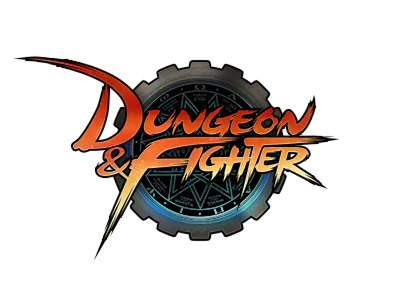
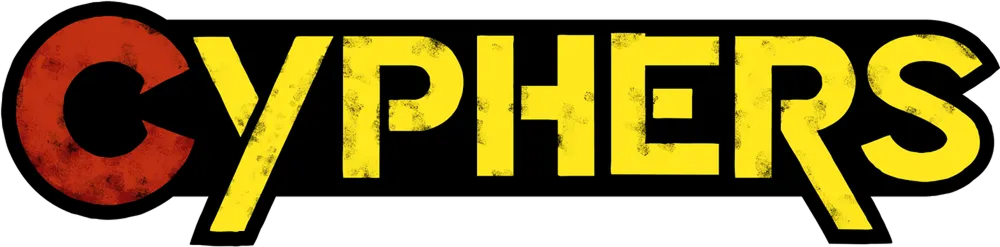

# nexon-open-api

> Type-safe Nexon Open API SDK for TypeScript/JavaScript

[](https://www.npmjs.com/package/nexon-open-api)
[](https://github.com/Kimhasa/nexon-open-api-sdk/actions/workflows/ci.yml)
[](https://codecov.io/gh/Kimhasa/nexon-open-api-sdk)
[](https://opensource.org/licenses/MIT)
[](https://nodejs.org/)

[Nexon Open API](https://openapi.nexon.com/)를 TypeScript로 감싼 SDK입니다. 현재 메이플스토리, 메이플스토리M, MapleStorySEA, EA SPORTS FC 온라인을 지원하며 나머지 게임은 순차적으로 추가합니다([지원 게임](#지원-게임)). 외부 의존성 없이 네이티브 `fetch`만 사용하며, CJS/ESM 듀얼 출력을 지원합니다.

## 설치

```bash
npm install nexon-open-api
# or
yarn add nexon-open-api
# or
pnpm add nexon-open-api
```

## 빠른 시작

### 메이플스토리

```ts
import { NexonClient } from 'nexon-open-api';

const client = new NexonClient({ apiKey: 'YOUR_API_KEY' });

// OCID 조회
const ocid = await client.maplestory.getOcid('캐릭터명');

// 캐릭터 기본 정보
const basic = await client.maplestory.character.getBasic({ ocid });
console.log(`${basic.character_name} Lv.${basic.character_level}`);
```

### 메이플스토리M

```ts
// OCID 조회 (월드명 필요)
const ocid = await client.maplestorym.getOcid('스카니아', '캐릭터명');

// 캐릭터 기본 정보
const basic = await client.maplestorym.character.getBasic({ ocid });
```

### MapleStorySEA

```ts
// OCID 조회
const ocid = await client.maplestorySEA.getOcid('CharacterName');

// 캐릭터 기본 정보
const basic = await client.maplestorySEA.character.getBasic({ ocid });
console.log(`${basic.character_name} Lv.${basic.character_level}`);

// 유니온 정보
const union = await client.maplestorySEA.union.getUnion({ ocid });
```

### FC Online

```ts
// OUID 조회
const ouid = await client.fcOnline.getOuid('닉네임');

// 유저 기본 정보
const basic = await client.fcOnline.getBasic(ouid);
console.log(`${basic.nickname} (Lv.${basic.level})`);

// 매치 기록 조회
const matchIds = await client.fcOnline.getMatchList({ ouid, matchtype: 50, limit: 10 });
const detail = await client.fcOnline.getMatchDetail(matchIds[0]!);
```

### 그 밖의 게임

모든 게임이 같은 패턴입니다: 식별자 조회(`getOcid` / `getOuid`) → 카테고리별 sub-client.

```ts
// MapleStory Taiwan
const twOcid = await client.maplestoryTW.getOcid('角色名稱');
const twBasic = await client.maplestoryTW.character.getBasic({ ocid: twOcid });

// 퍼스트 디센던트
const tfdOuid = await client.firstDescendant.getOuid('닉네임#1234');
const tfdUser = await client.firstDescendant.user.getBasic({ ouid: tfdOuid });
const descendants = await client.firstDescendant.meta.getDescendant('ko'); // 정적 메타데이터

// 마비노기 영웅전
const heroesOcid = await client.mabinogiHeroes.getOcid('캐릭터명');
const heroesBasic = await client.mabinogiHeroes.character.getBasic({ ocid: heroesOcid });

// 서든어택
const saOuid = await client.suddenAttack.getOuid('닉네임');
const matches = await client.suddenAttack.match.getList({ ouid: saOuid, match_mode: '폭파미션' });

// 마비노기
const items = await client.mabinogi.auction.listItems({ auction_item_category: '검' });

// 바람의나라 (서버 이름 필요)
const baramOcid = await client.baram.getOcid('캐릭터명', '연');
const baramBasic = await client.baram.character.getBasic({ ocid: baramOcid });

// 넥슨 Open API 공지
const { notice } = await client.platform.getNoticeList();
```

게임별 전체 API는 아래 [상세 문서](#상세-문서)를 참고하세요.

> API 키는 [Nexon Open API 포털](https://openapi.nexon.com/)에서 발급받을 수 있습니다.

## 주요 특징

- **Type-safe** — 모든 API 응답에 대한 완전한 TypeScript 타입 정의
- **Branded Types** — `OCID`, `OUID`, `GuildId`, `NexonDate` 브랜드 타입으로 컴파일 타임 안전성
- **자동 재시도** — 429 (Rate Limit) / 503 응답 시 지수 백오프 자동 재시도
- **에러 분류** — `NexonRateLimitError`, `NexonAuthError` 등 `instanceof`로 에러 분기
- **외부 의존성 0** — Node.js 18+ 네이티브 `fetch` 사용
- **멀티 게임** — 하나의 `NexonClient`로 지원 게임 전체에 접근

## 지원 게임

넥슨 Open API 포털이 제공하는 **14개 게임 전부와 Open API 공지(`client.platform`)를 지원**합니다 (2026-11-24 포털 기준, API 270개).

-  — SDK에 구현된 게임. 아래 버전과 날짜는 처음 포함된 버전과 구현일입니다.
- **API 개수** — "SDK public API 메서드 수"(메서드 1개 = 넥슨 API 경로 1개)입니다.

<!-- 아이콘 파일: docs/assets/games/{game}.png (48x48 권장) -->

<table width="100%" cellspacing="0" cellpadding="8" style="table-layout:fixed;width:100%">
<tr>
<td align="center" valign="top" width="33%">
<br>

<h4>EA SPORTS FC 온라인</h4>
 <br>
<sub>v0.1.1 · 2026-03-04</sub><br>
<br>
<a href="docs/fc-online.md">레퍼런스</a><br>
<br>
</td>
<td align="center" valign="top" width="33%">
<br>

<h4>메이플스토리</h4>
 <br>
<sub>v0.1.0 · 2026-03-04</sub><br>
<br>
<a href="docs/maplestory.md">레퍼런스</a><br>
<br>
</td>
<td align="center" valign="top" width="33%">
<br>

<h4>메이플스토리M</h4>
 <br>
<sub>v0.1.1 · 2026-03-05</sub><br>
<br>
<a href="docs/maplestory-m.md">레퍼런스</a><br>
<br>
</td>
</tr>
<tr>
<td align="center" valign="top" width="33%">
<br>

<h4>MapleStorySEA</h4>
 <br>
<sub>v0.1.1 · 2026-03-09</sub><br>
<br>
<a href="docs/maplestory-sea.md">레퍼런스</a><br>
<br>
</td>
<td align="center" valign="top" width="33%">
<br>

<h4>MapleStoryTaiwan</h4>
 <br>
<sub>v0.2.0 · 2026-11-24</sub><br>
<br>
<a href="docs/maplestory-tw.md">레퍼런스</a><br>
<br>
</td>
<td align="center" valign="top" width="33%">
<br>

<h4>서든어택</h4>
 <br>
<sub>v0.2.0 · 2026-11-24</sub><br>
<br>
<a href="docs/sudden-attack.md">레퍼런스</a><br>
<br>
</td>
</tr>
<tr>
<td align="center" valign="top" width="33%">
<br>

<h4>퍼스트 디센던트</h4>
 <br>
<sub>v0.2.0 · 2026-11-24</sub><br>
<br>
<a href="docs/first-descendant.md">레퍼런스</a><br>
<br>
</td>
<td align="center" valign="top" width="33%">
<br>

<h4>마비노기</h4>
 <br>
<sub>v0.2.0 · 2026-11-24</sub><br>
<br>
<a href="docs/mabinogi.md">레퍼런스</a><br>
<br>
</td>
<td align="center" valign="top" width="33%">
<br>

<h4>마비노기 영웅전</h4>
 <br>
<sub>v0.2.0 · 2026-11-24</sub><br>
<br>
<a href="docs/mabinogi-heroes.md">레퍼런스</a><br>
<br>
</td>
</tr>
<tr>
<td align="center" valign="top" width="33%">
<br>

<h4>카트라이더 러쉬플러스</h4>
 <br>
<sub>v0.2.0 · 2026-11-24</sub><br>
<br>
<a href="docs/kartrider.md">레퍼런스</a><br>
<br>
</td>
<td align="center" valign="top" width="33%">
<br>

<h4>바람의나라</h4>
 <br>
<sub>v0.2.0 · 2026-11-24</sub><br>
<br>
<a href="docs/baram.md">레퍼런스</a><br>
<br>
</td>
<td align="center" valign="top" width="33%">
<br>

<h4>히트2</h4>
 <br>
<sub>v0.2.0 · 2026-11-24</sub><br>
<br>
<a href="docs/hit2.md">레퍼런스</a><br>
<br>
</td>
</tr>
<tr>
<td align="center" valign="top" width="33%">
<br>

<h4>바람의나라: 연</h4>
 <br>
<sub>v0.2.0 · 2026-11-24</sub><br>
<br>
<a href="docs/baram-yeon.md">레퍼런스</a><br>
<br>
</td>
<td align="center" valign="top" width="33%">
<br>

<h4>V4</h4>
 <br>
<sub>v0.2.0 · 2026-11-24</sub><br>
<br>
<a href="docs/v4.md">레퍼런스</a><br>
<br>
</td>
<td width="33%"></td>
</tr>
</table>

### 포털 대비 지원 범위

2026-11-24 넥슨 Open API 포털 스펙과 대조한 결과, **포털의 API 270개를 모두 지원합니다** (14개 게임 + platform).

| 게임                                   | SDK 메서드 | 포털 API 경로                                                         |
| -------------------------------------- | ---------- | --------------------------------------------------------------------- |
| 메이플스토리                           | 56         | 56                                                                    |
| 메이플스토리M                          | 38         | 38                                                                    |
| MapleStorySEA                          | 26         | 26                                                                    |
| MapleStory Taiwan                      | 27         | 27                                                                    |
| EA SPORTS FC 온라인                    | 18         | 19 (이미지 4개 경로를 URL 헬퍼 2개로 지원, [상세](docs/fc-online.md)) |
| 퍼스트 디센던트                        | 42         | 42                                                                    |
| 마비노기 영웅전                        | 19         | 19                                                                    |
| 서든어택                               | 11         | 11                                                                    |
| 카트라이더 러쉬플러스                  | 9          | 9                                                                     |
| 바람의나라                             | 7          | 7                                                                     |
| 마비노기                               | 5          | 5                                                                     |
| 바람의나라: 연                         | 4          | 4                                                                     |
| V4                                     | 4          | 4                                                                     |
| 히트2                                  | 2          | 2                                                                     |
| 넥슨 Open API 공지 (`client.platform`) | 1          | 1                                                                     |

넥슨이 포털을 바꾸면 주간 모니터가 감지해 스펙 갱신 PR을 열고, CI의 `specs:drift --strict` 검사가 SDK 타입과 공식 스펙의 차이를 막습니다. 자세한 내용은 [specs/README.md](specs/README.md)를 참고하세요.

### 범위 외: 네오플 API

던전앤파이터와 사이퍼즈는 넥슨 Open API가 아니라 [네오플 Developers](https://developers.neople.co.kr/) API로 제공됩니다. 호스트와 API 키가 달라 이 SDK의 지원 범위에 포함하지 않습니다.

| 게임                                                                                              | API 문서                                                                        |
| ------------------------------------------------------------------------------------------------- | ------------------------------------------------------------------------------- |
|  던전앤파이터 | [네오플 던전앤파이터 API](https://developers.neople.co.kr/contents/apiDocs/df)  |
|  사이퍼즈                     | [네오플 사이퍼즈 API](https://developers.neople.co.kr/contents/apiDocs/cyphers) |

## 에러 처리

SDK는 Nexon API 에러 코드를 구체적인 에러 클래스로 분류합니다.

```ts
import {
  NexonRateLimitError,
  NexonAuthError,
  NexonNotFoundError,
  NexonDataNotReadyError,
} from 'nexon-open-api';

try {
  const basic = await client.maplestory.character.getBasic({ ocid });
} catch (err) {
  if (err instanceof NexonRateLimitError) {
    // 429 — 요청 한도 초과 (SDK가 자동으로 3회 재시도 후 throw)
    console.log(`재시도 대기: ${err.retryAfterMs}ms`);
  }
  if (err instanceof NexonAuthError) {
    // 403 — API 키 오류 또는 권한 없음
  }
  if (err instanceof NexonNotFoundError) {
    // 캐릭터/길드를 찾을 수 없음
  }
  if (err instanceof NexonDataNotReadyError) {
    // 해당 날짜 데이터 미준비 (매일 오전 1시 KST 이후 갱신)
  }
}
```

## 설정 옵션

```ts
const client = new NexonClient({
  apiKey: 'YOUR_API_KEY',
  timeoutMs: 10_000, // 요청 타임아웃 (기본: 10초)
  maxRetries: 3, // 429/503 재시도 횟수 (기본: 3)
  retryBaseDelayMs: 500, // 재시도 기본 대기시간 (기본: 500ms)
  debug: true, // 콘솔 디버그 로그 활성화
});
```

### 커스텀 로거

```ts
const client = new NexonClient({
  apiKey: 'YOUR_API_KEY',
  logger: {
    onRequest: (info) => console.log(`→ ${info.method} ${info.url}`),
    onResponse: (info) => console.log(`← ${info.status} (${info.durationMs}ms)`),
    onRetry: (info) => console.warn(`↩ retry #${info.attempt} after ${info.waitMs}ms`),
  },
});
```

## Sub-path Import

특정 게임 코드만 번들에 포함하고 싶다면 sub-path import를 사용하세요.

```ts
import { MapleStoryClient } from 'nexon-open-api/maplestory';
import { MapleStoryMClient } from 'nexon-open-api/maplestory-m';
import { MapleStorySEAClient } from 'nexon-open-api/maplestory-sea';
import { FcOnlineClient } from 'nexon-open-api/fconline';
import { MapleStoryTWClient } from 'nexon-open-api/maplestory-tw';
import { FirstDescendantClient } from 'nexon-open-api/first-descendant';
import { MabinogiHeroesClient } from 'nexon-open-api/mabinogi-heroes';
import { SuddenAttackClient } from 'nexon-open-api/sudden-attack';
import { KartriderClient } from 'nexon-open-api/kartrider';
import { BaramClient } from 'nexon-open-api/baram';
import { MabinogiClient } from 'nexon-open-api/mabinogi';
import { BaramYeonClient } from 'nexon-open-api/baram-yeon';
import { V4Client } from 'nexon-open-api/v4';
import { Hit2Client } from 'nexon-open-api/hit2';
import { PlatformClient } from 'nexon-open-api/platform';
```

## 상세 문서

| 게임                  | 문서                                     | 카테고리                                        |
| --------------------- | ---------------------------------------- | ----------------------------------------------- |
| 메이플스토리          | [API 레퍼런스](docs/maplestory.md)       | 캐릭터, 유니온, 길드, 랭킹, 확률/이력, 공지사항 |
| 메이플스토리M         | [API 레퍼런스](docs/maplestory-m.md)     | 캐릭터, 유니온, 길드, 랭킹, 공지사항            |
| MapleStorySEA         | [API 레퍼런스](docs/maplestory-sea.md)   | 캐릭터, 유니온, 길드                            |
| FC Online             | [API 레퍼런스](docs/fc-online.md)        | 계정 정보, 매치, 랭커, 메타데이터, 이미지 URL   |
| MapleStory Taiwan     | [API 레퍼런스](docs/maplestory-tw.md)    | 캐릭터, 유니온, 길드                            |
| 퍼스트 디센던트       | [API 레퍼런스](docs/first-descendant.md) | 계정, 메타데이터, 추천 모듈, 리더보드           |
| 마비노기 영웅전       | [API 레퍼런스](docs/mabinogi-heroes.md)  | 캐릭터, 메타(인챈트), 거래소, 랭킹, 공지사항    |
| 서든어택              | [API 레퍼런스](docs/sudden-attack.md)    | 계정, 매치, 메타데이터                          |
| 카트라이더 러쉬플러스 | [API 레퍼런스](docs/kartrider.md)        | 계정, 공지사항                                  |
| 바람의나라            | [API 레퍼런스](docs/baram.md)            | 캐릭터                                          |
| 마비노기              | [API 레퍼런스](docs/mabinogi.md)         | NPC 상점, 경매장, 거대한 외침의 뿔피리          |
| 바람의나라: 연        | [API 레퍼런스](docs/baram-yeon.md)       | 캐릭터                                          |
| V4                    | [API 레퍼런스](docs/v4.md)               | 캐릭터                                          |
| 히트2                 | [API 레퍼런스](docs/hit2.md)             | 캐릭터                                          |
| 넥슨 Open API 공지    | [API 레퍼런스](docs/platform.md)         | 공지 사항                                       |

## 요구사항

- Node.js 18+
- TypeScript 5.0+ (타입 사용 시)

## 면책 조항

이 프로젝트는 넥슨(NEXON Korea Corporation)이 제휴, 승인, 후원하지 않는 **비공식** 서드파티 라이브러리입니다.

- 이 SDK에서 사용하는 모든 게임명, 로고 및 관련 상표의 권리는 넥슨에 있습니다 ([이용약관 제6조 ①](https://openapi.nexon.com/ko/support/terms/)).
- 이 SDK는 [NEXON Open API](https://openapi.nexon.com/)를 통해 데이터를 제공받습니다 ([이용약관 제6조 ④](https://openapi.nexon.com/ko/support/terms/)).
- API 사용 시 [Nexon Open API 이용약관](https://openapi.nexon.com/ko/support/terms/)을 준수해 주세요.

## 라이선스

이 SDK의 소스 코드는 [MIT](LICENSE) 라이선스를 따릅니다.
단, API를 통해 제공되는 데이터의 저작권은 넥슨에 있으며, 데이터의 무단 복제/재배포/영리적 이용은 이용약관에 의해 제한됩니다.
